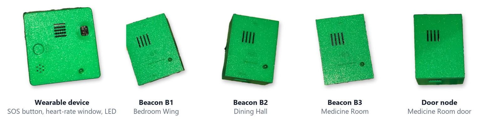
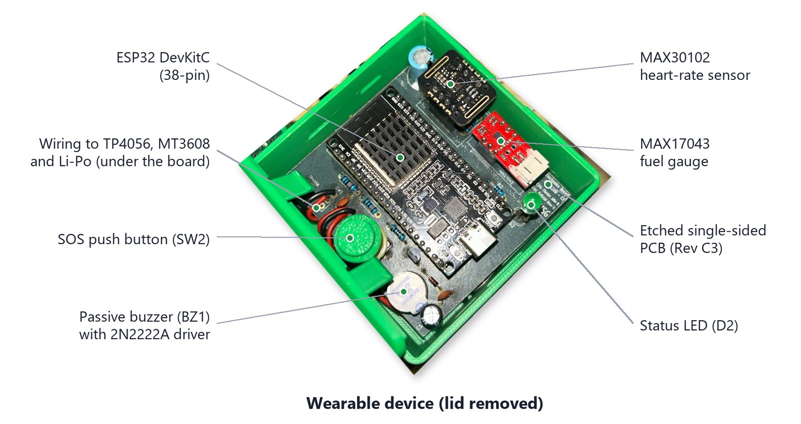
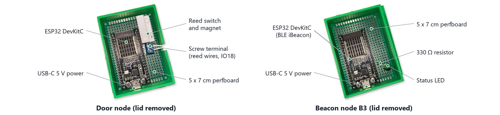
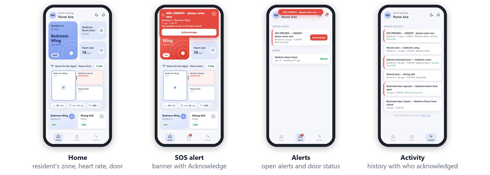
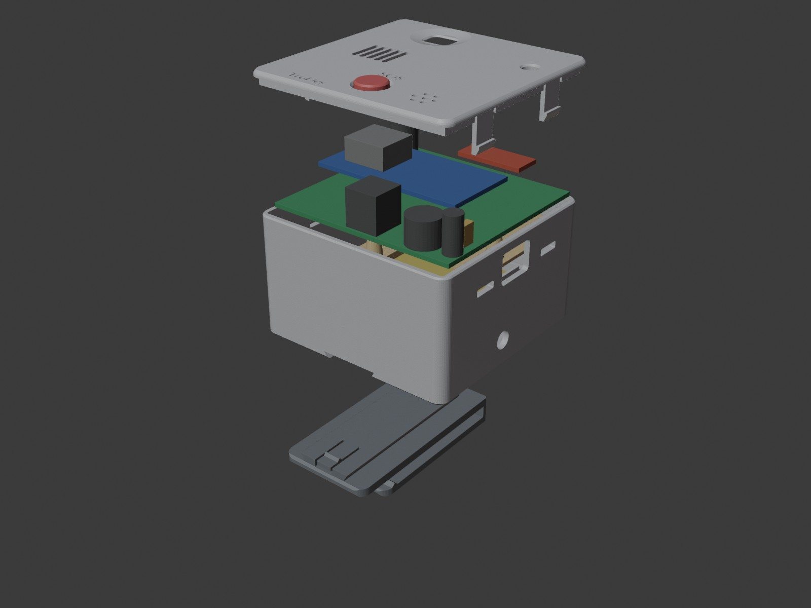
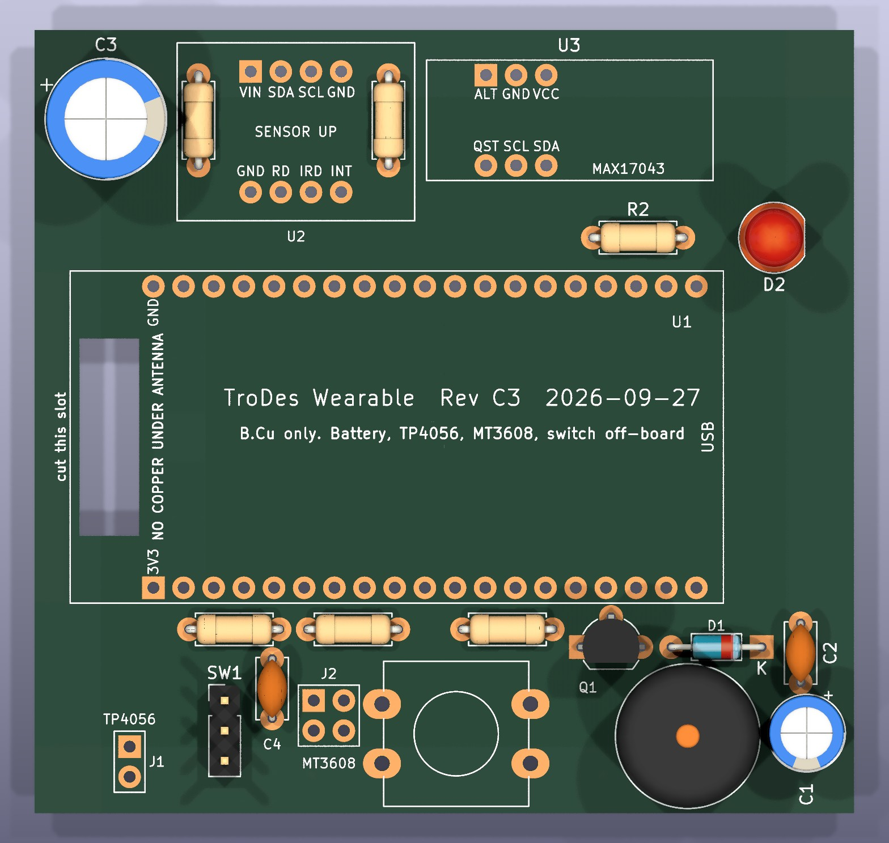

# SESEM: indoor BLE safety monitoring for a home for the aged



**An ESP32 wearable, three BLE zone beacons and a door sensor node that tell caregivers which room a resident is in and raise SOS and restricted-door alerts on a phone dashboard, with no internet connection required.**

*Electronics Design (ECEA120D), Section C1, Mapúa University, October 2026. Authors: Chester John B. Cirio and Pathrish Anne R. Cruz. Adviser: Engr. Glenn V. Magwili. The prototype is called SESEMSG in the final paper (TroDes in earlier drafts). It was defended before a three-member panel on 1 October 2026.*

## My part

Two-person team, adviser-approved design decisions.

- **Led system architecture and hardware selection.** Chose BLE over UWB, Wi-Fi RSSI, RFID and GPS with a weighted decision matrix (BLE 4.30, UWB 3.40, Wi-Fi RSSI 3.35, RFID 2.75, GPS 2.25; the scores are the team's assessment, paper section 3.12), and selected the ESP32 and the boost power chain.
- **Designed the wearable's single-sided PCB in KiCad** (69 × 66 mm; 0 design-rule errors, 0 unconnected pads) **and its 3D-printed PLA enclosure.**
- **Redesigned the wearable's power chain** to a boost topology when no low-dropout regulator could be sourced in time, then traced a power-path fault from measured voltages (battery 3.83 V, converter output 3.25 V against 5.0 V expected).

*Built with AI coding assistance: parts of the firmware, dashboard code and documentation were written with an AI assistant (Claude), so some commits in the history carry its name. The hardware design, decisions and testing are the authors'.*

## What it does

- **Zone tracking.** The wearable listens for iBeacon advertisements, smooths each signal, and reports the zone of the strongest beacon. It never estimates distance. Three zones were demonstrated: bedroom wing and dining hall (safe), medicine room (restricted).
- **SOS.** One, two or three button presses set the urgency; holding the button for 3 s cancels an open SOS. A caregiver acknowledges it on the dashboard and the wearable returns to normal.
- **Restricted door.** A reed switch on the medicine-room door raises an alert when it opens.
- **Heart rate and battery** are reported to the dashboard (heart rate is informational, not clinical).
- **No internet needed.** The door node doubles as a stand-alone hub: it runs its own Wi-Fi network and serves the caregiver dashboard to phones. The same firmware can instead report to a computer on a facility network.
- **Network loss.** The wearable queues events while the link is down and delivers them when it reconnects.

## System block diagram


*(a) Stand-alone hub as demonstrated. (b) Facility-network alternative with a computer running the dashboard. Remote viewing through a cloud relay is shown dashed: it was built and tested locally and not deployed.*

## Photos and renders



**Wearable, lid removed.** ESP32 DevKitC on the etched single-sided Rev C3 board, MAX30102 heart-rate sensor, SOS button, buzzer with transistor driver and status LED.



**Door node and beacon node, lids removed.** Both are an ESP32 DevKitC on a 5 × 7 cm perfboard in a printed enclosure. The door node adds a reed switch and magnet on a screw terminal (GPIO 18).



**Caregiver dashboard on a phone.** Home (zone, heart rate, door), SOS banner with Acknowledge, open alerts, and an activity history that records who acknowledged. Names and readings shown are test data.



**Wearable enclosure, exploded view.** A 3-D model render, not a photograph. The enclosure is printed in PLA with a captive SOS plunger and a fingertip window over the heart-rate sensor.



**Wearable board, Revision C3.** KiCad 3-D view of the single-sided carrier board (69 × 66 mm) for the ESP32 and sensor modules. This is a render, not a photograph.

## Measured results

All values come from the final paper and the raw captures it cites. These are small prototype tests, not field trials.

| Test | Result | Notes |
|---|---|---|
| Zone classification, Test 2 Run 1 (24 Sep 2026, earlier firmware) | 56.2 % overall (278 of 495 samples); 23.2 % unresolved; no errors across the tested wall | One run, 16 labelled points. Two of the three beacons shared one open room, which caused the lower score. |
| Coverage | Beacon received at every tested distance up to 6 m in line of sight, at least 11.9 dB above the −88 dBm detection floor | Range beyond 6 m and other wall types were not measured. |
| Signal strength vs distance (Test 1) | Fitted path-loss exponents 0.28 and 0.55 (free space is 2.0) | This is why zones are chosen by comparing beacons, not by estimating distance. |
| SOS delivery to the hub | Median 295 ms, maximum 408 ms (n = 6) | Timed on the wearable's own clock up to the hub's reply; the full event-to-phone delay was not timed. |
| Restricted-door detection | 4 of 4 openings detected | 3 on 29 Sep and 1 in the 30 Sep demonstration. The planned 20 cycles were not run. |
| Dashboard checks | Backend self-test 38 of 38; hub network checks 17 of 17 | |
| Multi-resident load test | 10 to 200 simulated wearables on one laptop; every resident name, zone and SOS attributed correctly | Simulated. The two-wearable hardware test was not performed. |


*Test 1, received signal strength against distance (run A), with the −88 dBm detection floor and the 11.9 dB margin at 6 m.*

### Limitations: not measured

- **Battery runtime.** Not measured. The calculated runtime for the 2000 mAh cell is about 20 h in the test profile and about 33 h in the low-power profile, against a 24 h target.
- **Zone accuracy on the final firmware.** Not reported; the capture of that run was overwritten.
- **Complete event-to-phone delay.** Not timed; the paper gives a stage-by-stage estimate only.
- **Coverage beyond 6 m and through other wall types.** Not measured.
- **Two-wearable hardware test.** Not performed.

## Tech stack

| Layer | What was used |
|---|---|
| Microcontroller | ESP32 (ESP32-WROOM-32 DevKitC) in all three device types: wearable, beacon, door node |
| Wireless | Bluetooth Low Energy iBeacon advertising (beacons at +9 dBm, every 100 ms), passive scanning on the wearable; Wi-Fi (WPA2) from wearable to hub |
| Firmware | PlatformIO with the Arduino framework |
| Dashboard and backend | Python, FastAPI and SQLite, as a web page that opens on any phone browser; the door node serves the same API as a stand-alone hub |
| Sensors and power | MAX30102 heart-rate sensor, reed switch, Li-Po cell with TP4056 charger and MT3608 boost converter, resistor divider for battery sensing |
| Hardware design | KiCad 9 (schematic, board, design-rule check), perfboard for beacons and door node |
| Enclosures | Blender models, printed in PLA on a Bambu Lab A1 |
| Tools | Python analysis scripts for the test data, Git |

## Repository layout

```
firmware/
  beacon_node/      ESP32 iBeacon advertiser, one flashed board per zone
  wearable/         ESP32 wearable: BLE scan, zone logic, SOS, heart rate, battery, Wi-Fi
  door_sensor/      ESP32 reed switch node for restricted doors
tools/
  rssi_calibration/ serial capture and Test 1/2/3 analysis scripts
dashboard/          caregiver web dashboard: FastAPI + SQLite, simulator, self-tests
docs/               programming guide, test guides, zone config, project status
CHANGELOG.md        dated log of every code change
```

**Quick start**

- Firmware: see [docs/BOARD_PROGRAMMING_GUIDE.md](docs/BOARD_PROGRAMMING_GUIDE.md).
- Tests: see [docs/PHASE1_TEST_GUIDE.md](docs/PHASE1_TEST_GUIDE.md).
- Dashboard data contract (what the firmware posts): [docs/DASHBOARD_BUILD_BRIEF.md](docs/DASHBOARD_BUILD_BRIEF.md).
- Team notes and the full project map: [docs/PROJECT_MAP.md](docs/PROJECT_MAP.md).
