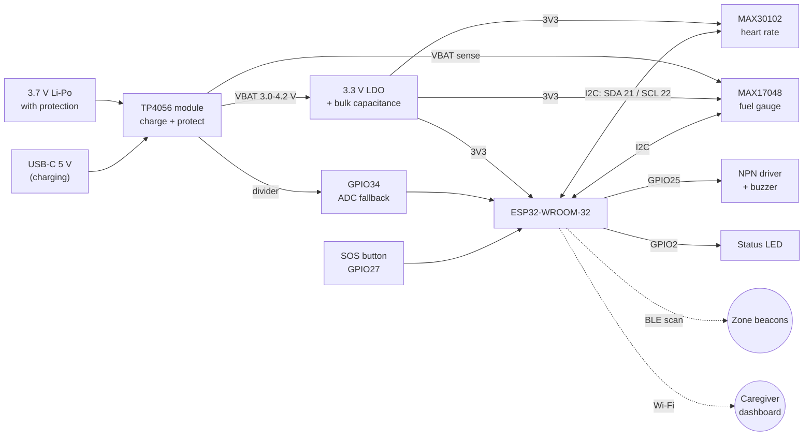

# Wearable Board — Schematic and Wiring Specification

Version 1.0 · 13 September 2026

This document is the source of truth for wiring the wearable. Use it twice:

1. **Now** — to wire the breadboard prototype with the real sensors, so Tests 2
   and 3 run on the same circuit you will fabricate.
2. **Then** — to draw the schematic in KiCad and lay out the single-sided board.

Every pin assignment below already matches
`firmware/wearable/include/config.h`. If you change a pin here, change it there
and reflash, or nothing will work and the fault will look like hardware.

---

## 1. Block diagram



Use this as the block diagram figure in the paper. Redraw it properly for the
final submission; this is the content, not the artwork.

---

## 2. Connection table — the authoritative net list

| ESP32 pin | Net | Connects to | Notes |
|---|---|---|---|
| 3V3 | `+3V3` | LDO output | **Feed the devkit's 3V3 pin directly.** See §4 warning |
| GND | `GND` | Common ground | Multiple GND pins — tie them all |
| GPIO 21 | `SDA` | MAX30102 SDA, MAX17048 SDA | 4.7 kΩ pull-up to +3V3 *if the modules lack one* |
| GPIO 22 | `SCL` | MAX30102 SCL, MAX17048 SCL | Same |
| GPIO 27 | `SOS_BTN` | Pushbutton → GND | Internal pull-up; **no external resistor needed** |
| GPIO 25 | `BUZZ_DRV` | 1 kΩ → NPN base | Driven with a ~2.7 kHz tone |
| GPIO 2 | `LED_STAT` | 330 Ω → LED anode | Strapping pin — see §6 |
| GPIO 34 | `VBAT_SENSE` | Divider midpoint | Input-only pin. Correct choice here |

**Do not use GPIO 6–11.** On the 38-pin board they appear as `SD0`, `SD1`,
`SD2`, `SD3`, `CMD`, `CLK` and are wired to the SPI flash. Using one prevents
the board from booting and looks like a dead board.

---

## 3. Power tree and current budget

```
USB-C 5 V ──► TP4056 (with DW01 protection) ──► VBAT (3.0–4.2 V)
                                                  │
                              ┌───────────────────┼──────────────────┐
                              ▼                   ▼                  ▼
                     MAX17048 CELL pin     Divider → GPIO34      3.3 V LDO
                                                                     │
                                                                     ▼
                                              +3V3 ──► ESP32, MAX30102, MAX17048
```

### Current budget

| Load | Average | Peak |
|---|---|---|
| ESP32, continuous active BLE scan | 95–115 mA | — |
| ESP32, Wi-Fi transmit burst | — | **250–350 mA** |
| ESP32, project average (5 s reporting) | ~60 mA | — |
| MAX30102, red LED at 0x0A | ~1 mA | ~5 mA |
| MAX17048 | ~23 µA | — |
| Buzzer during an alert | — | ~25 mA |
| Status LED | ~5 mA | — |
| Battery divider (100 kΩ + 100 kΩ) | ~21 µA | — |
| **System** | **~60 mA** | **~380 mA** |

At ~60 mA average, a 1000 mAh cell gives roughly **16 hours**. That is under a
working day. The duty cycle is a firmware decision — see
`wearable/include/config.h` — but do not change it until the adviser sets a
target runtime.

### The regulator problem — unresolved, needs the adviser

**MCP1700-3.3 is rated 250 mA. Peak demand is ~380 mA.** An under-specced
regulator produces brownout resets that present as random crashes and are
miserable to diagnose after the board is etched.

Three ways forward, in order of preference:

1. **Substitute a higher-current LDO.** `AP2112K-3.3` (600 mA, 55 µA quiescent,
   SOT-23-5) or `MCP1826S-3302` (1 A, 120 µA quiescent). Both keep the low
   quiescent current that mattered in the original choice.
2. **Keep the MCP1700 and add bulk capacitance** — 470 µF electrolytic plus
   10 µF ceramic right at the ESP32's 3V3 pin. The capacitor supplies the
   millisecond transmit burst; the LDO only has to supply the average. This
   works in practice but is less defensible on paper.
3. Do both. This is what I would actually build.

**Useful fact for the discussion:** the ESP32 operates down to 3.0 V, so an LDO
briefly in dropout still delivers usable voltage. The problem is current
capability, not regulation accuracy.

---

## 4. Feeding the board — read this before wiring power

If you are using a **devkit** (recommended for a first self-etched board),
connect your 3.3 V regulator output to the devkit's **3V3 pin**. This bypasses
the on-board AMS1117 regulator, which cannot work from a 3.7 V cell anyway.

**Never connect anything to VIN/5V at the same time.** Two supplies fighting
across the on-board regulator is how devkits die.

**Add a power switch.** An SPDT slide switch selecting *battery* or *off*
prevents the battery feeding the board while USB is also connected for
programming. Without it, remember to disconnect the cell before plugging in
USB — and you will forget at least once.

---

## 5. Component wiring, block by block

### 5.1 Charging and protection — TP4056 module

| Module pin | Connects to |
|---|---|
| IN+ / IN− | USB-C 5 V input (or the module's own USB connector) |
| BAT+ / BAT− | Li-Po cell |
| OUT+ | `VBAT` net — to LDO input, MAX17048 CELL, divider top |
| OUT− | `GND` |

**Use the version with protection** (TP4056 + DW01 + dual MOSFET). The bare
TP4056 has no over-discharge cutoff and will destroy the cell.

### 5.2 Regulator

| Node | Component |
|---|---|
| LDO IN | `VBAT`, with 1 µF ceramic to GND |
| LDO OUT | `+3V3`, with 1 µF ceramic + 10 µF ceramic + 470 µF electrolytic to GND |
| LDO GND | `GND` |

Place the 10 µF and the bulk capacitor **as close to the ESP32's 3V3 pin as the
layout allows**. Distance defeats the purpose.

Add **100 nF** from VCC to GND at each module (ESP32, MAX30102, MAX17048).

### 5.3 Battery sense divider → GPIO 34

```
VBAT ──[ 100 kΩ ]──┬──[ 100 kΩ ]── GND
                    │
                    ├── GPIO 34
                    │
                   100 nF
                    │
                   GND
```

Ratio 2.0, matching `BATTERY_DIVIDER_RATIO` in firmware. At 4.2 V the ADC sees
2.1 V, within range for the 11 dB attenuation the firmware sets.

The 100 nF stabilises the reading — the ESP32 ADC dislikes high source
impedance, and 50 kΩ is high. If readings are noisy, drop to 47 kΩ + 47 kΩ at
the cost of ~45 µA.

This divider is a **fallback**. The MAX17048 is the primary gauge. Fit it
anyway; it costs two resistors and covers you if the gauge module fails.

### 5.4 MAX30102 heart rate module

| Module pin | Connects to |
|---|---|
| VIN | `+3V3` |
| GND | `GND` |
| SDA | GPIO 21 |
| SCL | GPIO 22 |
| INT | Not connected — firmware polls |

Mount it **skin-facing**, on the underside of the enclosure. Optical heart rate
needs firm, consistent skin contact; a loose sensor reads nothing and the
firmware will correctly report no finger detected.

### 5.5 MAX17048 fuel gauge module

| Module pin | Connects to |
|---|---|
| VDD | `+3V3` |
| GND | `GND` |
| SDA | GPIO 21 |
| SCL | GPIO 22 |
| CELL / BAT | **`VBAT`** — before the regulator |

That last row matters: the gauge measures the cell, not the regulated rail. Wire
it to the wrong side and it will report a flat 3.3 V forever.

### 5.6 SOS button

```
GPIO 27 ──┬── Pushbutton ── GND
          │
        100 nF (optional)
          │
         GND
```

Internal pull-up is enabled in firmware. The 100 nF is optional hardware
debounce; firmware already debounces at 40 ms.

Mount it where a resident can press it deliberately but not by accident — a
recessed or shrouded button. This is a design point the panel may well ask about.

### 5.7 Buzzer driver

```
+3V3 ──┬── Buzzer ──┬── NPN collector
       │            │
       └── 1N4148 ──┘   (cathode to +3V3)

GPIO 25 ──[ 1 kΩ ]── NPN base
                     NPN emitter ── GND
```

NPN: 2N2222, BC547, or S8050. Any small-signal NPN rated above 100 mA.

**Fit the 1N4148 flyback diode.** Many "passive buzzers" are magnetic
transducers and therefore inductive; without the diode the switching spike
degrades the transistor. If yours is genuinely piezoelectric the diode is
harmless.

The firmware drives this with a square-wave tone, so the buzzer must be
**passive**. An active buzzer ignores the tone and just beeps at its own
frequency — the distinct alert patterns in the firmware would all sound the same.

### 5.8 Status LED

```
GPIO 2 ──[ 330 Ω ]── LED anode; LED cathode ── GND
```

**GPIO 2 is a strapping pin and must not be pulled high at reset.** An LED to
ground through a resistor is a weak pull-down, which is safe. Never put a
pull-up on it.

If you are using a devkit, it already has an LED on GPIO 2 and an external one
is redundant — though a panel-visible indicator on the enclosure is still worth
having.

---

## 6. Schematic drawing rules — course requirement

**"Schematics must use IEEE standard symbols only."** This is a hard rule and an
easy source of lost marks.

KiCad defaults to **IEC** symbols for some parts — the rectangular resistor. You
need the **ANSI/IEEE** zigzag. In the symbol chooser, pick the `_US` variants:

| Part | Use this KiCad symbol |
|---|---|
| Resistor | `Device:R_US` (zigzag) — **not** `Device:R` (rectangle) |
| Potentiometer | `Device:R_POT_US` |
| Inductor | `Device:L_US` |
| Capacitor, non-polarised | `Device:C` |
| Capacitor, polarised | `Device:C_Polarized_US` |
| Diode | `Device:D` |
| NPN transistor | `Device:Q_NPN_BCE` |
| LED | `Device:LED` |

Also required for a clean schematic:

- Every component gets a reference designator (R1, C1, U1, Q1, D1, SW1, BT1)
  and a value
- Label nets by name (`+3V3`, `GND`, `VBAT`, `SDA`, `SCL`) rather than drawing
  long wires across the page
- Use proper power and ground symbols
- Add a title block: project, board name, revision, date, authors

---

## 7. Single-sided layout rules for hand etching

Hand-etched boards have no solder mask, no silkscreen, and no plated
through-holes. Design for that from the start rather than fighting it.

| Rule | Value | Why |
|---|---|---|
| Minimum trace width | **0.4 mm (16 mil)** | Etching undercuts; thinner traces break |
| Power traces | **≥ 1.0 mm (40 mil)** | 380 mA peaks |
| Minimum clearance | **0.5 mm (20 mil)** | Toner transfer is not precise |
| Pad diameter | **≥ 2.0 mm** for 0.8 mm holes | Survives drilling slightly off-centre |
| Vias | **None** | Use jumper wires on the component side |

**Antenna keep-out — non-negotiable.** Position the ESP32 so its antenna end
**overhangs the edge of the board**. No copper, no traces, no ground pour, no
components under or beside the antenna. A degraded antenna degrades RSSI, which
degrades zone detection, which is the entire project.

**Ground:** on a single-sided board you cannot pour a ground plane under
everything. Run a **wide ground bus** (≥1.5 mm) around the perimeter and branch
from it. Keep the regulator, bulk capacitor and ESP32 ground returns short and
close together.

**Routing order** — route these first, then everything else:

1. `+3V3` from the regulator to the ESP32 and the bulk capacitor
2. `GND` bus
3. `VBAT` to the regulator, gauge and divider
4. `SDA`/`SCL` — keep them together and away from the buzzer trace
5. Everything else

**Mark jumper positions** on the board with a permanent marker after etching;
you cannot print a silkscreen. Keep a printed copy of the layout with jumpers
highlighted.

---

## 8. Test points — add these, they cost nothing

Four exposed pads, 2 mm, labelled by marker:

| Pad | Net | Used for |
|---|---|---|
| TP1 | `VBAT` | Cell voltage under load |
| TP2 | `+3V3` | Rail voltage — check under Wi-Fi burst |
| TP3 | `GND` | Meter reference |
| TP4 | `SDA` | I2C debugging if a sensor is not found |

TP2 is the one that will tell you whether the regulator is sagging. Worth having
before you need it.

---

## 9. Bring-up order — follow this exactly

This sequence is what saves a board. Skipping to step 5 is what kills one.

1. **Inspect the etched board** against a bright light. Look for hairline
   breaks and bridges between adjacent traces.
2. **Continuity test before soldering anything.** `+3V3` to `GND` must read
   **open**. If it beeps, find the short now.
3. **Solder the power section only** — regulator, capacitors, TP4056 connections.
   No ESP32, no modules.
4. **Apply the battery and measure TP2.** You should read 3.25–3.35 V. Do not
   proceed until you do.
5. **Fit the ESP32.** Power on, confirm it boots and prints its banner.
6. **Fit the modules one at a time**, checking after each that the firmware
   reports it found. A single short on one module's I2C lines takes down the
   whole bus, and adding them one at a time tells you which one.
7. **Then** fit the button, buzzer and LED.

---

## 10. Open items

| Item | Status |
|---|---|
| Regulator choice | **Blocked** — awaiting adviser on the 250 mA concern (§3) |
| Battery capacity | **Blocked** — depends on the target runtime, not yet set |
| Devkit vs bare WROOM module | Recommend devkit for the prototype; state it in the paper |
| Enclosure and strap | Not started — matters for the demo |

---

## 11. Related

`guides/Bill_of_Materials.md` · `guides/Board_Programming_Guide.md` ·
`status/Plan_To_Defense.md` · `firmware/wearable/include/config.h`
